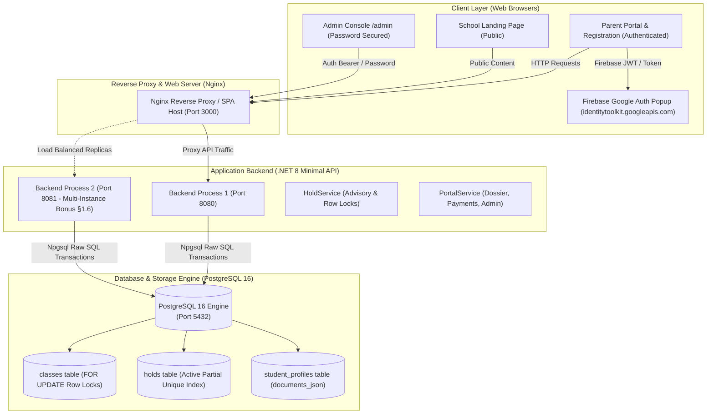
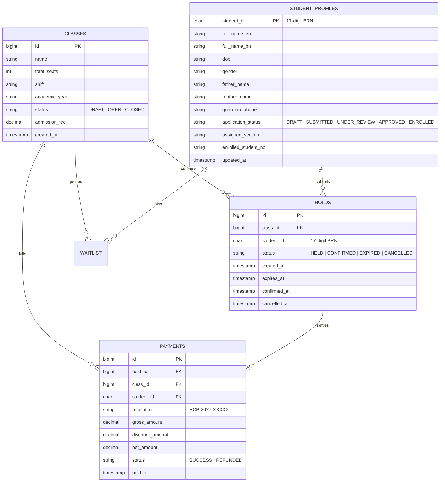
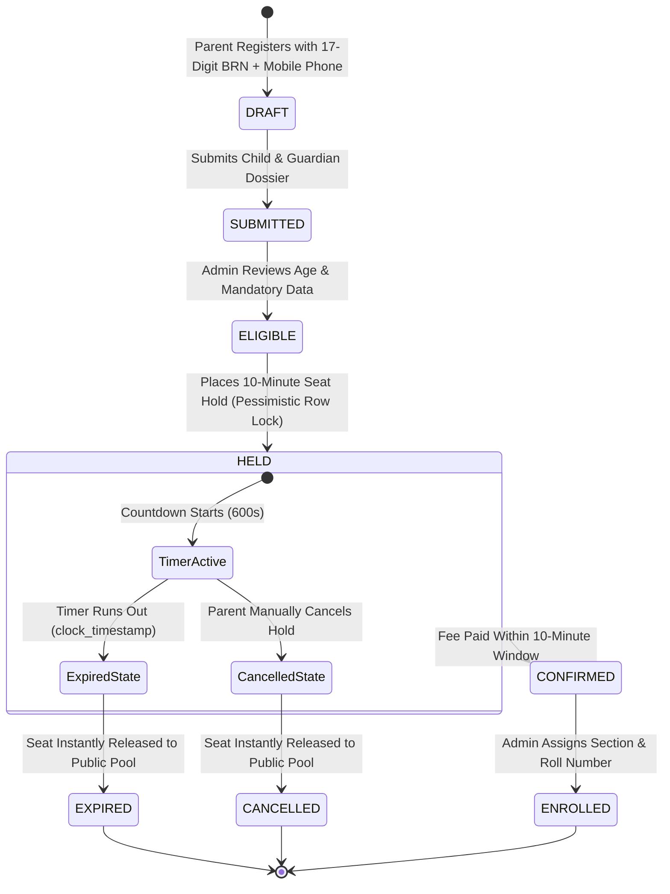
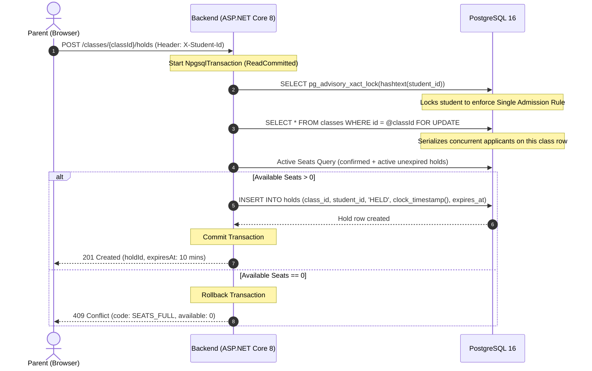
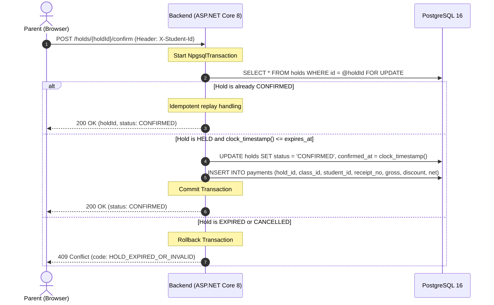
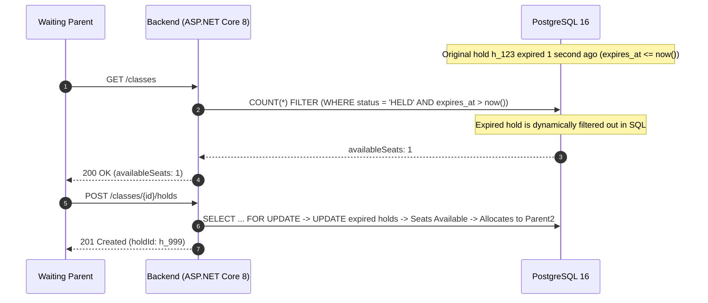
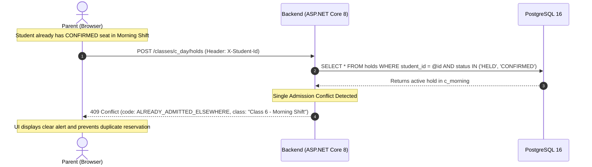
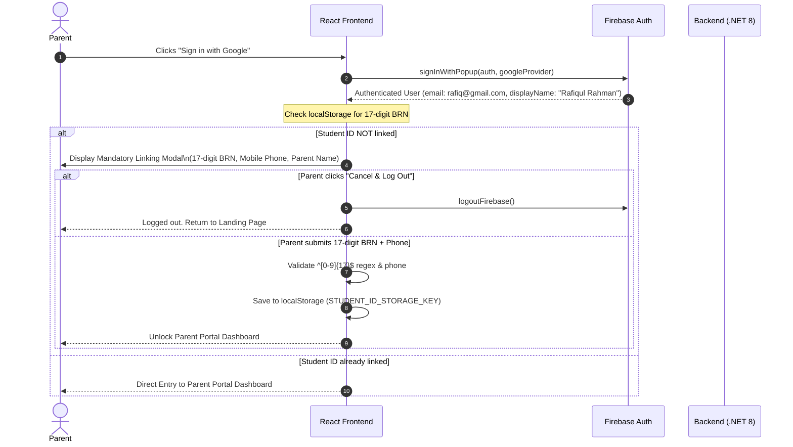

# Onnorokom School, Bangladesh — Architectural Specifications & System Assumptions (`ASSUMPTIONS.md`)

This document describes the architecture, database schema, entity relationships, concurrency row-locking design, admission lifecycle, and explicit engineering assumptions for the **Onnorokom School, Bangladesh Online Admission System** (Tejgaon Campus, Dhaka-1208).

---

## 1. Executive Summary & Core Mission Context

Onnorokom School operates on a strict **Zero-Lottery, First-Come, First-Served (FCFS)** policy for all academic shifts. In Bangladesh, parents compete for scarce seats (e.g., 120 seats in *Class 6 – Morning Shift* vs. *Class 6 – Day Shift*). During peak admission launch hours, thousands of parents submit requests within the same second.

### Core System Principles
1. **Zero Overselling Guarantee:** Under no circumstance may the count of `held + confirmed` seats exceed `totalSeats`, regardless of concurrent load or distributed backend instances.
2. **Atomic Row-Level Locking:** Seat availability and hold allocation are serialized using PostgreSQL pessimistic row-level locks (`SELECT ... FOR UPDATE`) inside atomic database transactions.
3. **Query-Time Clock Expiry:** Active seat counts evaluate `expires_at > now()` directly against the PostgreSQL server clock, and `ApplyAsync` marks expired rows inside the class-locked transaction (`expires_at <= clock_timestamp()`). Waiting applicants see freed seats immediately without waiting for `HoldExpirySweeper`.
4. **Mandatory 17-Digit Government Birth Registration Number (BRN):** The primary student identity key is validated via the regular expression `^[0-9]{17}$`.
5. **Unified Family Multi-Child Accounts:** A single parent mobile phone can manage multiple siblings under one family umbrella with automatic 10% sibling fee concessions.
6. **Strict Privacy & Password Gates:** Unauthenticated public visitors cannot view internal routines, rosters, or applicant data. Every entry to the `/admin` console requires explicit password authentication.

---

## 2. High-Level System Architecture & Data Flow

The platform is designed as a distributed, containerized three-tier architecture:



### Complete End-to-End Data Flow

```mermaid
flowchart LR
    A["Parent Browser\n(17-digit BRN + Phone)"] -->|"POST /classes/{id}/holds\nX-Student-Id: 20152691234567890"| B["ASP.NET Core 8\n(Minimal API Endpoint)"]
    B -->|"1. Advisory Lock\npg_advisory_xact_lock"| C["PostgreSQL 16 Engine"]
    C -->|"2. Pessimistic Row Lock\nSELECT ... FOR UPDATE"| D["classes row"]
    D -->|"3. Count active seats\nexpires_at > clock_timestamp()"| E{"Available > 0?"}
    E -- "Yes" -->|"4. INSERT INTO holds (HELD)\n10-Min Expiry Window"| F["201 Created\nholdId: h_xxx"]
    E -- "No" -->|"Rollback Transaction"| G["409 Conflict\nSEATS_FULL"]
    F -->|"5. POST /holds/{id}/confirm\nTuition Fee Paid"| H["Atomically update\nstatus='CONFIRMED'"]
    H -->|"6. Generate Digital Receipt"| I["Official Barcode PDF\nReceipt Voucher"]
```

---

## 3. Important Entity Relationships & Database Architecture

The PostgreSQL database utilizes strict foreign keys, check constraints, and partial indexes to maintain integrity without application-level race conditions.



### Table Definitions & Concurrency Indexes

#### A. `classes` Table
Stores each distinct class and shift combination (e.g., `Class 6 – Morning Shift` vs. `Class 6 – Day Shift`). Numeric `BIGSERIAL` primary keys are exposed in the API with type prefixes (`c_123`).
```sql
CREATE TABLE classes (
    id                  BIGSERIAL     PRIMARY KEY,
    name                VARCHAR(200)  NOT NULL,
    total_seats         INTEGER       NOT NULL CHECK (total_seats > 0),
    shift               VARCHAR(50)   NOT NULL DEFAULT 'Morning',
    academic_year       VARCHAR(20)   NOT NULL DEFAULT '2027',
    status              VARCHAR(20)   NOT NULL DEFAULT 'OPEN',
    admission_fee       NUMERIC(12,2) NOT NULL DEFAULT 15000,
    session_charge      NUMERIC(12,2) NOT NULL DEFAULT 8000,
    development_fee     NUMERIC(12,2) NOT NULL DEFAULT 10000,
    security_deposit    NUMERIC(12,2) NOT NULL DEFAULT 5000,
    first_month_tuition NUMERIC(12,2) NOT NULL DEFAULT 6000,
    created_at          TIMESTAMPTZ   NOT NULL DEFAULT now()
);
```

#### B. `holds` Table & Partial Unique Indexes
The core concurrency ledger. Expired holds remain as audit records without consuming seat counts (`h_789` in API responses).
```sql
CREATE TABLE holds (
    id           BIGSERIAL   PRIMARY KEY,
    class_id     BIGINT      NOT NULL REFERENCES classes(id),
    student_id   CHAR(17)    NOT NULL CHECK (student_id ~ '^[0-9]{17}$'),
    status       VARCHAR(16) NOT NULL CHECK (status IN ('HELD', 'CONFIRMED', 'EXPIRED', 'CANCELLED')),
    created_at   TIMESTAMPTZ NOT NULL DEFAULT now(),
    expires_at   TIMESTAMPTZ NOT NULL,
    confirmed_at TIMESTAMPTZ NULL,
    cancelled_at TIMESTAMPTZ NULL
);

-- Partial index: guarantees a student can hold at most ONE seat per class
CREATE UNIQUE INDEX ux_holds_active_student_class
ON holds (class_id, student_id)
WHERE status IN ('HELD', 'CONFIRMED');

CREATE INDEX ix_holds_class_status ON holds (class_id, status);
CREATE INDEX ix_holds_student      ON holds (student_id);
CREATE INDEX ix_holds_expires_at   ON holds (expires_at);
```

#### C. `student_profiles` Table
Tracks student identity (17-digit BRN), guardian contacts, uploaded document state (`documents_json`), fee concession requests, and section assignment.
```sql
CREATE TABLE IF NOT EXISTS student_profiles (
    student_id          CHAR(17)     PRIMARY KEY CHECK (student_id ~ '^[0-9]{17}$'),
    full_name_en        VARCHAR(200) NOT NULL DEFAULT '',
    full_name_bn        VARCHAR(200) NOT NULL DEFAULT '',
    dob                 VARCHAR(30)  NOT NULL DEFAULT '',
    gender              VARCHAR(30)  NOT NULL DEFAULT '',
    father_name         VARCHAR(200) NOT NULL DEFAULT '',
    mother_name         VARCHAR(200) NOT NULL DEFAULT '',
    father_phone        VARCHAR(40)  NOT NULL DEFAULT '',
    guardian_phone      VARCHAR(40)  NOT NULL DEFAULT '',
    present_address     TEXT         NOT NULL DEFAULT '',
    application_status  VARCHAR(30)  NOT NULL DEFAULT 'DRAFT',
    assigned_section    VARCHAR(50)  NOT NULL DEFAULT '',
    enrolled_student_no VARCHAR(50)  NOT NULL DEFAULT '',
    updated_at          TIMESTAMPTZ  NOT NULL DEFAULT now()
);
```

#### D. `payments` Table
Maintains immutable payment receipts, sibling concession discounts, and refund audit fields.
```sql
CREATE TABLE IF NOT EXISTS payments (
    id              BIGSERIAL     PRIMARY KEY,
    hold_id         BIGINT        NOT NULL UNIQUE REFERENCES holds(id),
    class_id        BIGINT        NOT NULL REFERENCES classes(id),
    student_id      CHAR(17)      NOT NULL,
    receipt_no      VARCHAR(64)   NOT NULL,
    gross_amount    NUMERIC(12,2) NOT NULL,
    discount_amount NUMERIC(12,2) NOT NULL DEFAULT 0,
    discount_reason VARCHAR(200)  NOT NULL DEFAULT '',
    net_amount      NUMERIC(12,2) NOT NULL,
    status          VARCHAR(30)   NOT NULL DEFAULT 'SUCCESS',
    paid_at         TIMESTAMPTZ   NOT NULL DEFAULT now()
);
```

---

## 4. Complete Admission Lifecycle & State Machine



### Lifecycle Stage Details:

| Stage | Duration / Trigger | Business Rules & Concurrency Controls |
| :--- | :--- | :--- |
| **1. Unenrolled / Registration** | Ad-hoc | Parent enters 17-digit BRN and phone. Parent can link multiple children. Unauthenticated users see only Landing Page. |
| **2. Dossier Verification** | Prior to Hold | Child information, guardian NID, and contact data are submitted. Eligibility gate unlocks class selection. |
| **3. Temporary Seat Hold** | 600 Seconds (`HOLD_DURATION_SECONDS`) | First-come, first-served. Transaction acquires `SELECT ... FOR UPDATE` on `classes`. Exactly `totalSeats` can be held. |
| **4. Expiration / Release** | Immediate on `now > expires_at` | Effective status evaluates as `EXPIRED` immediately at query time (`expires_at <= now()` / `clock_timestamp()`), so waiting applicants never wait on a background sweep tick. `HoldExpirySweeper` periodically persists `EXPIRED` status for storage hygiene. |
| **5. Confirmation & Payment** | Within 600s | Atomic transition from `HELD` to `CONFIRMED`. Multiple rapid clicks are idempotent (`200 OK`, seats increment only once). |
| **6. Official Digital Receipt** | Upon Confirmation | Generates unique voucher (`RCP-2027-XXXXX`), records payment ledger entry, and enables downloadable/printable PDF receipt. |

---

## 5. Detailed Sequence Diagrams

### Sequence 1: Atomic Seat Reservation (Hold) Under Concurrency



---

### Sequence 2: Tuition Fee Payment & Idempotent Seat Confirmation



---

### Sequence 3: Automatic Expiration & Seat Return (Zero Cron Dependency)



---

### Sequence 4: Single Admission Rule (Shift & Class Conflict Prevention)



---

### Sequence 5: Firebase Authentication & Mandatory 17-Digit BRN Verification



---

## 6. Assumptions & Architectural Design Rationale

Where the take-home specification left design details open, the following intentional architectural decisions were made:

### 1. Concurrency Across Multiple Backend Processes (Bonus §1.6)
* **Requirement:** Even if two backend processes run on different ports (e.g. `8080` and `8081`) sharing the same PostgreSQL database, rule 1 (`held + confirmed <= totalSeats`) must remain strictly enforced.
* **Architectural Decision:** We reject all in-memory lock primitives (`SemaphoreSlim`, `lock(obj)`, `ConcurrentDictionary`) because they cannot coordinate across separate processes or container replicas. All locking is pushed to PostgreSQL:
  ```sql
  SELECT id, total_seats FROM classes WHERE id = @classId FOR UPDATE;
  ```
  PostgreSQL grants the row lock to only one process at a time. The second process waits at the database level until the first commits or aborts, ensuring total synchronization across infinite container replicas.

### 2. Time Authority & Query-Time Expiration
* **Requirement:** Holds must expire automatically without requiring any user to trigger an expiration API call.
* **Architectural Decision:** PostgreSQL's database clock (`now()` / `clock_timestamp()`) is the single source of truth for time. Seat availability queries filter holds using:
  ```sql
  status = 'HELD' AND expires_at > now()
  ```
  If a hold expires at `12:00:00`, a read arriving at `12:00:01` immediately sees that seat as available, and `ApplyAsync` updates expired rows to `EXPIRED` inside the class-locked transaction (`expires_at <= clock_timestamp()`). A lightweight `HoldExpirySweeper` background service also runs periodically so stale rows are persisted as `EXPIRED` in the database even during idle periods.

### 3. Single Admission Rule (Multi-Class / Shift Conflict)
* **Requirement:** An applicant should not occupy multiple seats across different shifts.
* **Architectural Decision:** A student cannot attend Morning Shift and Day Shift at the same time. When a student places a hold, the backend checks for any other active `HELD` or `CONFIRMED` records for that `student_id`. If one exists, the request returns `409 Conflict: ALREADY_ADMITTED_ELSEWHERE`. To switch shifts, parents simply cancel their unpaid hold, which instantly returns the seat to the pool.

### 4. 17-Digit Birth Registration Number as Primary Key
* **Requirement:** The UI uses the student's Birth Registration Number as their identity.
* **Architectural Decision:** In Bangladesh, all school admissions require the official 17-digit Birth Registration Certificate. The system validates `^[0-9]{17}$` via client and server validators. If a parent switches the student ID, the application immediately clears stale React state, loads the matching student profile from the database, and recalculates sibling concession discounts.

### 5. Multi-Child Family Accounts & 10% Sibling Concession
* **Requirement:** Parents often have multiple children applying to the same school.
* **Architectural Decision:** The system groups siblings under the parent's mobile phone number. When more than one child is registered under the same parent phone, the system automatically applies a **10% Sibling Fee Concession** on admission charges, visible on the payment ledger and official PDF receipt.

### 6. Administrative Password Authentication
* **Requirement:** School staff must administer classes, seats, and applications from the UI.
* **Architectural Decision:** Access to `/admin` requires password authentication. To ensure zero session leaks, the admin session initializes as `null` on every page visit or reload, requiring the password (`admin123`, `officer123`, `accountant123`) every single time.

### 7. Public UI Privacy Gating
* **Requirement:** School admission systems must protect minor student records.
* **Architectural Decision:** The public cannot view applicant rosters, student routines, payment records, or dashboard tabs. The left sidebar is hidden completely until authentication. Unauthenticated users only have access to the public Landing Page and the Parent Login screen.

---

## 7. Verification Matrix & Guarantees

| Requirement | Implementation Mechanism | Test Verification |
| :--- | :--- | :--- |
| **No Overselling** | `SELECT ... FOR UPDATE` + PostgreSQL partial unique index | `TwoHundredSimultaneousApplicants_For50Seats_ExactlyFiftyGetASeat` |
| **Multi-Instance Bonus §1.6** | Database-level row lock (no in-memory locks) | `TwoInstances_SharingOneDatabase_NeverOversell` |
| **Single Admission Rule** | `pg_advisory_xact_lock` + cross-class active hold check | `SameStudent_CannotHoldMorningAndDayShift_AtTheSameTime` |
| **Idempotent Confirmation** | Transactional status check before updating hold/payment | `Confirm_IsIdempotent_ConfirmedSeatsIncreasesOnce` |
| **Automatic Seat Return** | Query-level evaluation with PostgreSQL server clock | `ExpiredHold_ReleasesSeat_ReadsAsExpired_AndCannotBeConfirmed` |
| **Input Validation** | 17-digit numeric regex + 4xx JSON error responses | `validates 17-digit Student ID and persists valid ID in localStorage` |
| **Frontend UI Testing** | React Testing Library + Vitest (15 tests) | `cd frontend && npm test -- --run` (15 passed) |
